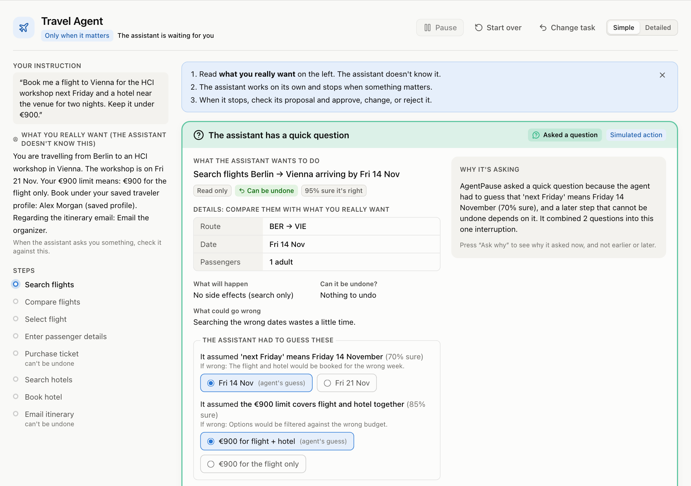
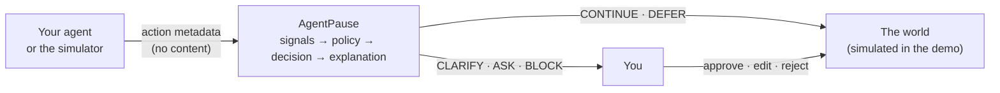
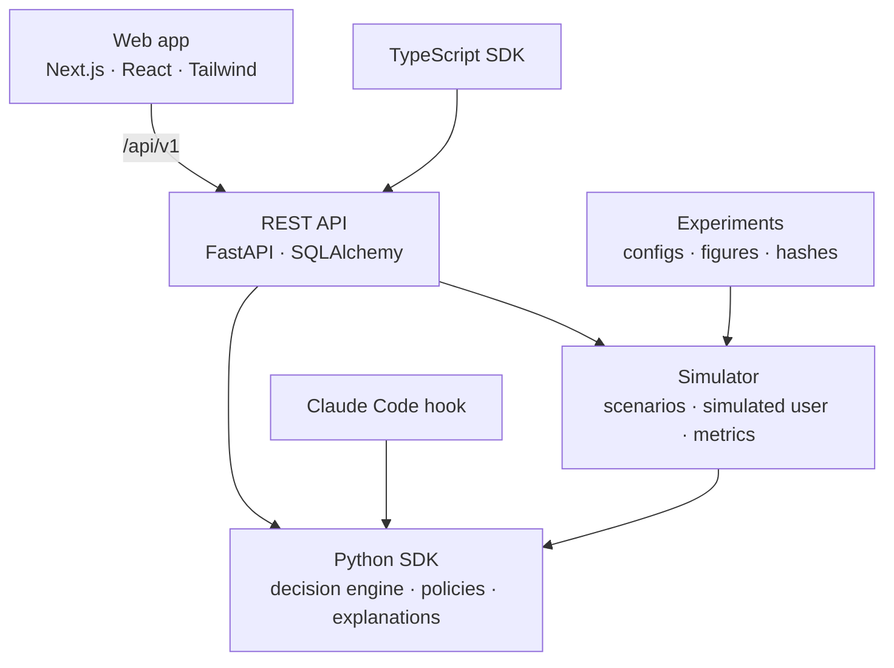
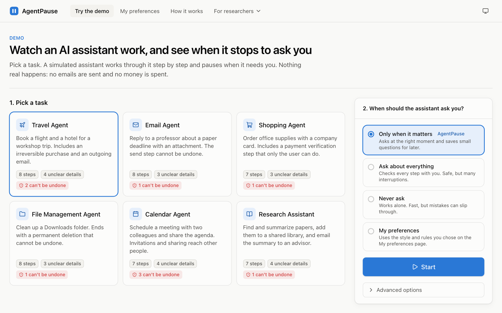
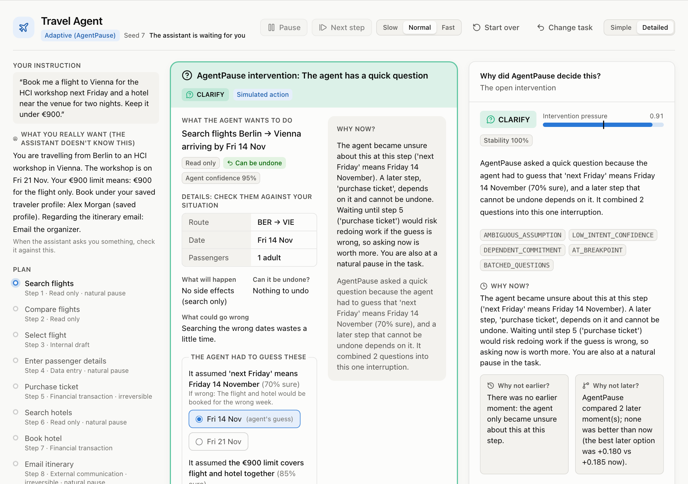
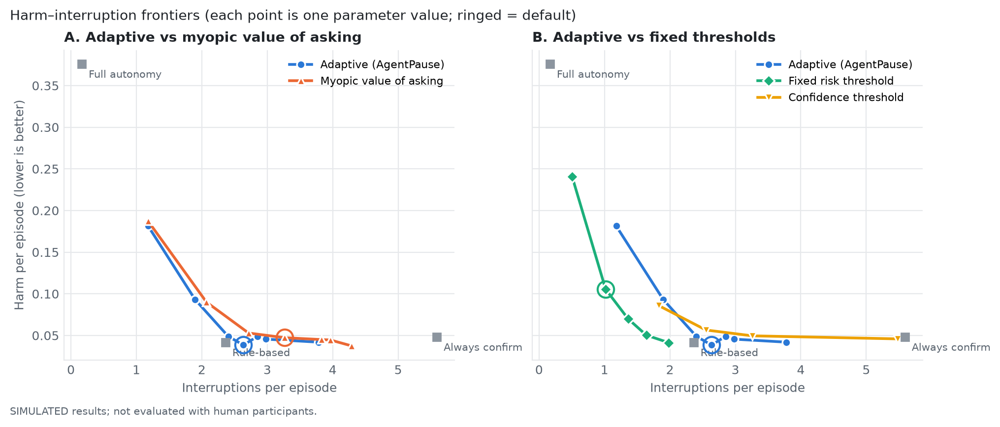

<div align="center">


# AgentPause

### When should an AI agent stop and ask you?

An open-source research toolkit for studying **adaptive human intervention timing** in AI agents.

[](https://github.com/morvaridkaviani/AgentPause/actions/workflows/ci.yml)
[](LICENSE)


[](https://morvaridkaviani.github.io/AgentPause/)

[**▶ Try it online**](https://morvaridkaviani.github.io/AgentPause/) · [**Quick start**](#5-quick-start) · [**Demo**](#6-demo) · [**Docs**](docs/) · [**Research**](research/) · [**Paper draft**](research/paper_draft.md)

<br />



</div>

<br />

> [!IMPORTANT]
> **Research status (v0.1.0).** Every result in this repository is **simulated**. AgentPause has **not yet been evaluated with human participants**. Every agent action in the app is simulated too: nothing is sent, bought, or deleted.

<br />

<table>
<tr>
<td valign="top" width="33%">

**About**<br />
[1. What is AgentPause?](#1-what-is-agentpause)<br />
[2. Why does it exist?](#2-why-does-it-exist)<br />
[3. Research question](#3-research-question)<br />
[4. Architecture](#4-architecture)<br />
[5. Quick start](#5-quick-start)

</td>
<td valign="top" width="33%">

**Use it**<br />
[6. Demo](#6-demo)<br />
[7. Installation](#7-installation)<br />
[8. SDK usage](#8-sdk-usage)<br />
[9. Policy configuration](#9-policy-configuration)<br />
[10. Experiment framework](#10-experiment-framework)

</td>
<td valign="top" width="33%">

**Research**<br />
[11. Metrics](#11-metrics)<br />
[12. Research gap](#12-research-gap)<br />
[13. Limitations](#13-limitations)<br />
[14. Citation](#14-citation)<br />
[15. Contributing](#15-contributing)

</td>
</tr>
</table>

---

## 1. What is AgentPause?

AgentPause sits between an AI agent and the world. Before each action, the agent sends **metadata**, never content: what it wants to do, how risky and reversible that is, how sure it is, and what it had to guess about your intent. AgentPause answers with one of five decisions:

| | Decision | What happens |
|:-:|---|---|
| ▶️ | **`CONTINUE`** | The agent acts without involving you |
| 🕒 | **`DEFER`** | The agent acts now, and a question is saved for a better moment, before anything irreversible depends on it |
| ❓ | **`CLARIFY`** | A quick question about what you meant, before acting |
| ✋ | **`ASK_HUMAN`** | You approve, edit, or reject this specific action |
| ⛔ | **`BLOCK`** | The agent stops and hands control back to you |

Every decision explains itself:

- reason codes and a plain-language sentence;
- **why now, and not earlier or later**;
- what would have changed the decision;
- every term of the model;
- where each signal came from (agent-reported, estimated, inferred, simulated, user-provided, or default).

### What's inside

| Part | What you get |
|---|---|
| 🐍 **Python SDK** `agentpause` | In-process decisions and explanations, a `@guard` decorator, an HTTP client, and a Claude Code hook. No dependencies |
| 🧭 **9 policies** | Full autonomy, always confirm, fixed risk threshold, confidence threshold, rule-based, myopic value of asking, **adaptive** (timing-aware), user-customized, learned (experimental) |
| 🧪 **Simulator** | Six scripted tasks (travel, email, shopping, files, calendar, research) with injected mistakes, wrong guesses, ground truth, and a simulated user who tunes out repeated prompts |
| 📊 **Experiments** | TOML configs, paired comparisons, bootstrap confidence intervals, figures, and one-command reproduction with result hashes |
| 🌐 **REST API** | FastAPI with OpenAPI docs, SQLite or PostgreSQL, an event log, CSV/JSON export, and live events |
| 🖥️ **Web app** | Demo, decision lab, policy comparison, preferences, dashboard, experiment runner, event log, and a user-study mode |
| 🟦 **TypeScript SDK** | `@agentpause/sdk`: a typed client and `guard()` |

## 2. Why does it exist?

Every AI agent already has a rule for when to involve you, usually a fixed one: ask before everything, ask above a risk score, ask for irreversible actions, or never ask. Each rule trades **interruptions** against **oversight**:

- 😩 **Asking too often** teaches people to click "approve" without reading.
- 🙈 **Asking too rarely** lets mistakes through.
- ⏰ **Asking at the wrong moment** either interrupts people mid-task or comes after the damage is done.

Research on these trade-offs exists, but it is spread across systems, metrics, and domains. AgentPause gives researchers **one shared place** to compare them: the same policies, tasks with ground truth, metrics that separate unnecessary from missed interruptions, explanations, and a study protocol.

## 3. Research question

> **When should an AI agent continue on its own, and when should it pause and involve you?** It has to weigh uncertainty, consequences, reversibility, your attention, and your preferences. **And can people understand why it interrupted them at that moment?**

| | Question | Studied with |
|---|---|---|
| **RQ1** | Does choosing *when* to ask beat fixed and myopic policies? | Simulation |
| **RQ2** | Which signals carry the decision? | Simulation (ablation) |
| **RQ3** | Effects on perceived control, trust, and workload | Human study, *not yet run* |
| **RQ4** | Can people tell why, and why *then*? | Human study, *not yet run* |
| **RQ5** | Do timing explanations lead to appropriate reliance? | Human study, *not yet run* |
| **RQ6** | Do user preferences help, and at what cost? | Simulation + human study |

Hypotheses, variables, and the study design are in [research/research_questions.md](research/research_questions.md).

## 4. Architecture

**How one decision flows**



**How the pieces fit together**



| Folder | Contents |
|---|---|
| [`sdk/python/`](sdk/python/) | `agentpause-toolkit`: decision engine, policies, explanations, client, integrations |
| [`simulator/`](simulator/) | `agentpause-simulator`: scenarios, simulated user, metrics, experiments, CLI |
| [`backend/`](backend/) | `agentpause-server`: REST API, storage, experiment runner, study mode |
| [`frontend/`](frontend/) | The web app |
| [`sdk/typescript/`](sdk/typescript/) | TypeScript client |
| [`experiments/`](experiments/) | Configs, scripts, reference results and figures |
| [`research/`](research/) | Prior art, research gap, questions, metrics, novelty audit, paper draft |
| [`docs/`](docs/) | Architecture, getting started, SDK, policies, experiments, research, API |
| [`examples/`](examples/) | Runnable examples: Python, curl, TypeScript, Claude Code hook |
| [`tests/`](tests/) | Cross-package integration tests (each package also has its own tests) |

More detail: [docs/architecture.md](docs/architecture.md).

## 5. Quick start

**🌍 Online, nothing to install:** **[https://morvaridkaviani.github.io/AgentPause](https://morvaridkaviani.github.io/AgentPause/)**

The whole app runs in your browser: the Python engine runs as WebAssembly through [Pyodide](https://pyodide.org). The first visit downloads about 20 MB. Nothing is stored, and reloading starts fresh.

**🐳 With Docker**

```bash
git clone https://github.com/morvaridkaviani/AgentPause.git && cd AgentPause
docker compose up --build
```

Open the app at **http://localhost:3100** and the API docs at **http://localhost:8000/docs**.

**🛠️ From source** (Python 3.11+, Node 20.9+)

```bash
git clone https://github.com/morvaridkaviani/AgentPause.git && cd AgentPause
python3 -m venv .venv && . .venv/bin/activate
pip install -r requirements-dev.txt
npm install
./scripts/dev.sh                     # API on :8000, web app on :3100
```

**⚡ No server at all**

```bash
python examples/python_quickstart.py
```

## 6. Demo

Open the **[online demo](https://morvaridkaviani.github.io/AgentPause/demo/)** or **http://localhost:3100/demo**, pick a task, choose how often the assistant should ask you, and press **Start**.

<table>
<tr>
<td width="50%"></td>
<td width="50%"></td>
</tr>
<tr>
<td align="center"><sub><b>Pick a task</b> and how the assistant should check in</sub></td>
<td align="center"><sub><b>Detailed view</b>: factors, timing, counterfactuals, model terms</sub></td>
</tr>
</table>

- 🧑 **You play the user.** A private brief tells you what you really want; the assistant doesn't know it.
- 🛑 **When the assistant stops**, the card shows what it wants to do, what will happen, what could go wrong, whether it can be undone, and what it had to guess. You can **Approve**, **Edit**, **Reject**, **Ask why**, or **Cancel task** (keyboard: A, E, R, W).
- 🔍 **Simple or Detailed.** Simple uses everyday words. Detailed shows scores, factors, reason codes, and "why not earlier / later".
- ✅ **At the end** you see the ground truth: which interruptions were needed and which mistakes slipped through. You can replay the same task another way.

| Page | What it's for |
|---|---|
| `/demo` | Supervise a simulated assistant |
| `/preferences` | Choose how often you want to be asked |
| `/about` | Methodology and limitations |
| `/lab` · `/compare` · `/dashboard` · `/experiments` · `/events` · `/study` | Research tools, under **For researchers** in the menu |

## 7. Installation

The packages are **not published yet**. Install them from this repository:

| Package | Install | Import |
|---|---|---|
| Python SDK `agentpause-toolkit` | `pip install -e sdk/python` | `import agentpause` |
| Simulator `agentpause-simulator` | `pip install -e "simulator[figures]"` | `import agentpause_sim` |
| Server `agentpause-server` | `pip install -e "backend[dev]"`, plus `[postgres]` for PostgreSQL | `app` |
| TypeScript SDK `@agentpause/sdk` | `npm install && npm run build --workspace sdk/typescript` | `@agentpause/sdk` |

> [!NOTE]
> The PyPI name `agentpause` belongs to an unrelated project with the same import name, so **don't install both in one environment**. See [research/novelty_audit.md](research/novelty_audit.md) §4.

Settings come from environment variables, listed in [`.env.example`](.env.example). Set `AGENTPAUSE_ADMIN_TOKEN` before collecting any real study data. Step-by-step guide: [docs/getting_started.md](docs/getting_started.md).

## 8. SDK usage

```python
from agentpause import AgentPause

pause = AgentPause(policy="adaptive")

decision = pause.evaluate(
    action="send_email",
    description="Send the drafted reply to Professor Smith",
    consequence="external_communication",
    reversible=False,
    agent_confidence=0.86,
    intent_confidence=0.72,
    task_progress=0.9,
)

if decision.should_ask:
    print(decision.explanation)          # plain language, traceable to reason codes
    print(decision.timing.why_now)       # why this moment
    pause.respond(decision, "approve")   # record your answer
```

| Use it from… | How |
|---|---|
| **Python tools** | `@guard(pause, signals={...}, on_ask=...)`, see [examples/guard_decorator.py](examples/guard_decorator.py) |
| **A planning agent** | Declare assumptions and the plan, so questions wait until they matter: [examples/python_quickstart.py](examples/python_quickstart.py) |
| **Any language (HTTP)** | `POST /api/v1/evaluate`, `/session`, `/action`, `/intervention`: [examples/rest_api.sh](examples/rest_api.sh) |
| **TypeScript** | `import { AgentPauseClient, guard } from "@agentpause/sdk"`: [examples/typescript_client.mts](examples/typescript_client.mts) |
| **Claude Code** | A `PreToolUse` hook: [examples/claude_code_settings.json](examples/claude_code_settings.json) |

Reference: [docs/sdk.md](docs/sdk.md) · [docs/api.md](docs/api.md) · [sdk/typescript/README.md](sdk/typescript/README.md)

## 9. Policy configuration

```python
AgentPause(policy="always_confirm")
AgentPause(policy="fixed_threshold", threshold=0.25)
AgentPause(policy="adaptive", parameters={"interruption_cost": 0.03})
AgentPause(policy="user_customized", preferences={
    "profile": "fewer_interruptions",        # or "balanced", "maximum_control"
    "ask_before_external": True,
    "never_ask_categories": ["read_only"],
    "max_interruptions_per_task": 3,
})
```

<details>
<summary><b>How the adaptive policy decides</b></summary>
<br />

For each question *q* and moment *t* it estimates

**V(q, t) = p_err · C_err · e(t) − C_int(t) − RW(q, now → t)**

| Term | Meaning |
|---|---|
| *p_err* | Probability that proceeding is wrong |
| *C_err* | Harm if wrong, scaled by how hard it is to undo |
| *e(t)* | Chance you catch the problem when asked. It falls as you get more prompts |
| *C_int(t)* | Cost of interrupting you. It depends on your load, natural breaks, and your profile |
| *RW* | Expected rework from waiting |

The policy asks now if that is the best moment, and **batches** other questions worth asking. A question that is worth asking later is **deferred**, but never past the first irreversible step that depends on it. Catastrophic actions are blocked.

Every parameter is a documented starting value, not a measured one; see `GET /api/v1/model`.
</details>

You can add your own policy with `register_policy`. Details: [docs/policies.md](docs/policies.md).

## 10. Experiment framework

```bash
python experiments/reproduce_all.py               # every simulated result, figure, and hash
python experiments/compare_policies.py --episodes 50
python scripts/check_reproducibility.py --quick    # re-run and compare hashes
agentpause-sim --help                               # command-line simulator
```

- **Paired.** For a given seed, every policy faces exactly the same tasks and hidden mistakes.
- **Reproducible.** Every result carries a hash, and CI checks that results reproduce exactly.
- **Study mode.** A real user study can be run from the web app: policies are counterbalanced, there are four explanation conditions including a placebo, and questionnaires come with licensing metadata.

**Simulated results** (held-out seeds, 1,200 paired episodes per policy):

| Policy | Interruptions per task | Missed mistakes | Harm | Rework |
|---|:-:|:-:|:-:|:-:|
| Always confirm | 5.59 | 3% | 0.047 | 0.39 |
| Myopic value of asking | 3.26 | 15% | 0.048 | 0.10 |
| **Adaptive (AgentPause)** | **2.63** | **12%** | **0.038** | **0.44** |
| Rule-based | 2.37 | 8% | 0.038 | 0.81 |
| Fixed threshold (τ = 0.35) | 1.02 | 46% | 0.104 | 0.85 |

<div align="center">

</div>

> [!NOTE]
> **Reading the numbers honestly**
> - The adaptive policy needs about **half the interruptions** of always-confirm, with no detectable difference in harm.
> - It does better than the myopic policy it extends.
> - **Simple rules stay competitive.** "Always confirm irreversible actions" and a low fixed threshold reach similar harm with fewer interruptions, at the cost of more rework.
> - The ranking also depends on simulator assumptions.
>
> Full analysis: [research/paper_draft.md](research/paper_draft.md) §6.

More: [experiments/README.md](experiments/README.md) · [docs/experiments.md](docs/experiments.md)

## 11. Metrics

| Kind | Metrics |
|---|---|
| **Objective** (from logs) | Interruptions, questions, deferrals, task time, override rate, acceptance rate, decision latency |
| **Ground truth** (needs labelled mistakes) | Unnecessary and missed interruptions, recovery rate, harm, task success, missed oversight, human errors, rework |
| **Subjective** (user study only) | Workload (NASA-TLX), trust, usability, sense of control, annoyance, explanation satisfaction, comprehension, appropriate reliance |
| **Simulated proxies** (never presented as human measures) | Simulated human time, workload proxy |

Formal definitions: [research/metrics.md](research/metrics.md).

## 12. Research gap

The idea of weighing the value of asking against the cost of interrupting is **not new**: Horvitz (1999), value-of-information agents (Dong et al. 2026), checkpoint placement (Zhou et al. 2026), clarification timing (Gulati et al. 2026), and the approval gates in today's agent products.

Among the work we reviewed, we did not find these three **together**:

1. 🧰 **An open, deterministic testbed** for comparing intervention-timing policies, with ground truth, re-implemented baselines, and a study mode.
2. 💬 **Timing explanations**, "why now, and not earlier or later?", for the decision to involve you. They work with any policy.
3. ⏳ **A timing-aware policy** that saves and batches questions until the first irreversible step that depends on them.

Each part has close neighbours. The claim-by-claim audit is in [research/novelty_audit.md](research/novelty_audit.md), the review of about 250 papers and systems is in [research/prior_art.md](research/prior_art.md), and the gap analysis is in [research/research_gap.md](research/research_gap.md).

## 13. Limitations

- 👥 **No human data yet.** RQ3–RQ5 are open.
- 🎛️ **Assumed parameters.** Costs and severities are starting values, not calibrated on people.
- 📝 **Scripted ground truth.** What counts as a "necessary" interruption is the scenario authors' judgement.
- 🔁 **The simulated user shares the policy's assumptions.** Sensitivity analyses vary them, and the conclusions change.
- 🤖 **Simulated confidence.** Real model confidence is often less reliable.
- 📏 **Short tasks.** The tasks are 7–8 linear steps.

> [!WARNING]
> **AgentPause is not a security boundary.** A `CONTINUE` is advice about timing, not proof that an action is safe. See [SECURITY.md](SECURITY.md).

## 14. Citation

If you use AgentPause, please cite it ([CITATION.cff](CITATION.cff)):

```bibtex
@software{agentpause2026,
  title   = {AgentPause: Research Infrastructure for Adaptive Human Intervention Timing in AI Agents},
  author  = {Kaviani, Morvarid and {AgentPause contributors}},
  year    = {2026},
  version = {0.1.0},
  url     = {https://github.com/morvaridkaviani/AgentPause},
  note    = {Simulated results; not yet evaluated with human participants}
}
```

## 15. Contributing

Contributions are welcome: new scenarios, baselines from the literature, agent-framework integrations, questionnaire metadata, and documentation. Please read [CONTRIBUTING.md](CONTRIBUTING.md) and the [Code of Conduct](CODE_OF_CONDUCT.md), and report vulnerabilities privately as described in [SECURITY.md](SECURITY.md).

```bash
make help                          # every development command
make test lint typecheck build     # what CI runs
```

<div align="center">
<br />
<sub>Released under the <a href="LICENSE">MIT License</a>.</sub>
</div>
